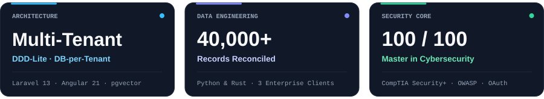

<div align="center">
  
</div>

<br />

<div align="center">
  <a href="https://linkedin.com/in/andrea-fiorletta-8a576a307">
    
  </a>
  <a href="mailto:andreafiorletta592@gmail.com">
    
  </a>
  
  
</div>

<br />

<div align="center">
  
</div>

---

### `whoami.py`

```python
class AndreaFiorletta:
    def __init__(self):
        self.role = "Software & Security Engineer"
        self.location = "Italy (CET)"
        self.focus = [
            "AI Safety, Red-Teaming & Evaluation Frameworks",
            "Multi-Tenant Data Isolation & Application Hardening (OWASP)",
            "RAG Pipelines & Semantic Memory (pgvector)",
            "Deterministic Data Reconciliation (Python / Rust)"
        ]
        self.production_scale = "40,000+ records reconciled across 3 enterprise clients"
        self.credentials = {
            "master": "Cybersecurity (100/100) — Thesis: Cybersecurity & Industry 4.0",
            "certifications": ["CompTIA Security+", "Anthropic AI Fluency & Claude Track"],
            "languages": ["Italian (Native)", "English (C1)", "Spanish (B1)"]
        }

    def mission(self) -> str:
        return "Engineering verifiable, isolated, and secure software for the AI era."
