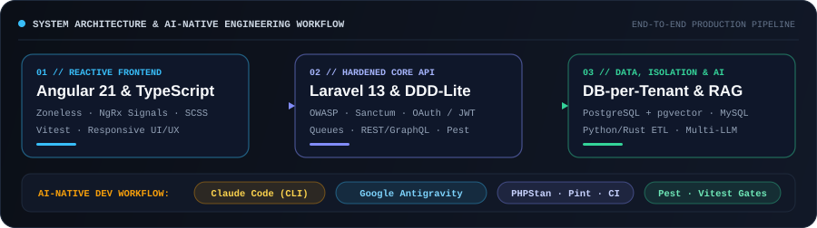

<div align="center">
  
</div>

<br />

<div align="center">
  <a href="https://linkedin.com/in/andrea-fiorletta-8a576a307">
    
  </a>
  <a href="mailto:andreafiorletta592@gmail.com">
    
  </a>
  
  
</div>

<br />

<div align="center">
  
</div>

<br />

<div align="center">
  
</div>

---

### `engineer.config.ts`

```typescript
export const AndreaFiorletta = {
  role: "Full-Stack Architect & Security Engineer",
  location: "Italy (CET)",
  architecture: {
    backend: ["Laravel 13", "PHP 8.4", "DDD-Lite", "Multi-Tenant (DB-per-Tenant)", "Async Queues"],
    frontend: ["Angular 21", "TypeScript", "Zoneless", "NgRx Signals", "SCSS / Bootstrap"],
    systemsAndData: ["Python", "Rust", "C++", "PostgreSQL + pgvector", "MySQL"],
    security: ["OWASP Hardening", "OAuth 2.0", "JWT", "Sanctum / Passport", "Strict Tenant Isolation"],
  },
  aiNativeWorkflow: {
    orchestration: ["Claude Code (Backend, Migrations, Audits)", "Google Antigravity (Frontend, UI/UX)"],
    knowledgeBase: "Obsidian Technical Vault & Structured Spec-Driven Prompts",
    qualityGates: ["Pest", "Vitest", "PHPStan", "Laravel Pint", "Prettier", "GitHub CI"],
  },
  productionHighlights: [
    "Designed multi-tenant SaaS ERP/PIM platform with isolated DB-per-tenant & dynamic landlord switching",
    "Reconciled & migrated 40,000+ product records across 3 enterprise clients via Python/Rust pipelines",
    "Integrated RAG & semantic memory (pgvector) with multi-provider LLM orchestration in production",
  ],
  languages: ["Italian (Native)", "English (C1)", "Spanish (B1)"],
} as const;
```

---

### Core Engineering Domains

| Domain | Architecture & Production Focus |
| :--- | :--- |
| **Multi-Tenant SaaS & Backend** | DDD-lite Laravel 13 platforms with dedicated relational databases per tenant, dynamic landlord switching, async job queues, and resilient REST/GraphQL integrations (Shopify, Google APIs) with rate-limit handling |
| **Modern Reactive Frontend** | High-craft Angular 21 & TypeScript interfaces using Zoneless change detection, `@ngrx/signals`, responsive tablet/mobile ergonomics, and strict visual polish |
| **Security & Hardening** | Defense-in-depth aligned with OWASP guidelines, SQLi/XSS mitigation, OAuth 2.0 / JWT / Sanctum authentication, and hard cross-tenant data boundaries (Master in Cybersecurity 100/100, CompTIA Security+) |
| **Applied AI & Data Integrity** | Production RAG pipelines with `pgvector`, multi-provider LLM orchestration, PyTorch/fine-tuning, plus deterministic Python & Rust data reconciliation scripts verified across 40,000+ records |
| **AI-Native Delivery Workflow** | Multi-agent software engineering combining **Claude Code** and **Google Antigravity**, backed by automated CI gates (`Pest`, `Vitest`, `PHPStan`, `Pint`, `Prettier`) for fast, regression-free shipping |

---

### Technology Ecosystem

**Backend, Systems & APIs**


**Frontend & UI Engineering**


**Data, AI & Security**


**AI-Native Tooling, Testing & DevOps**


---

### Open-Source & Engineering Lab

| Project | Stack | Description | Status |
| :--- | :--- | :--- | :---: |
| **`rag-tenant-guard`** | `Python` `pgvector` `Pytest` | Strict cross-tenant isolation & PII redaction boundary layer for multi-tenant RAG pipelines | `In Progress` |
| **`data-reconciler-cli`** | `Rust` `Python` `CLI` | High-speed deterministic CSV/JSONL schema validator, deduplicator & migration reconciler | `Planned` |
| **`llm-guardrail-bench`** | `Python` `CI` `JSON/MD` | Automated prompt-injection resilience & structured-output verification harness | `Planned` |

---

<div align="center">
  
</div>
